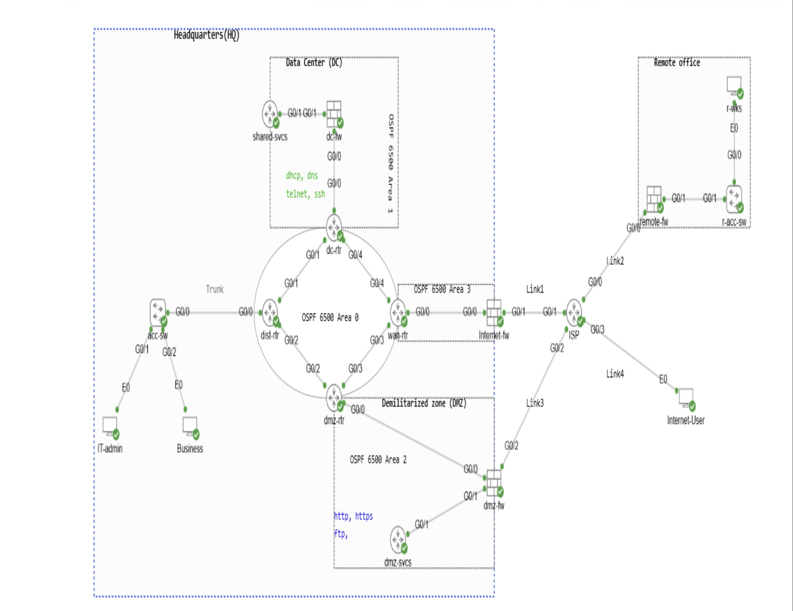

# Defense-in-Depth Enterprise Network

> A secure, multi-site corporate network with layered security built into every tier

A full enterprise network connecting a **Headquarters**, **Data Center**, **DMZ**, and **Remote Office** across an ISP, designed so security is enforced at every layer — addressing, routing, firewalls, services, access control, and the switch edge. The goal: seamless internal data flow while the internal structure stays hidden from the outside world.

---

## Design Highlights

| Layer | What was built |
|-------|----------------|
| **Addressing** | Hierarchical RFC 1918 private addressing internally; public addressing and NAT/PAT only at the network edge |
| **Segmentation** | VLAN 10 (IT) and VLAN 20 (Business) isolated with 802.1Q trunking; inter-VLAN routing forced through a Layer 3 policy point |
| **Routing** | Multi-area **OSPF** core with **routing-protocol authentication** to block rogue or spoofed route injection |
| **Firewalls** | Multiple **Cisco ASA** firewalls (Data Center, DMZ, Internet, Remote Office) with security zones, security levels, and stateful inspection |
| **Core services** | DHCP, DNS, NTP, SSH/Telnet on the shared-services server; HTTP/HTTPS and FTP published from the DMZ |
| **Access control** | Service-specific ACLs with logged default-deny, applied inbound/outbound on firewall interfaces |
| **Remote connectivity** | **Site-to-site IPsec VPN** (IKE Phase 1/2, crypto maps) linking the Remote Office to internal and DMZ services |
| **Edge publishing** | **Static NAT** publishes DMZ web/FTP services to a public IP; PAT allows controlled internal-to-Internet access |
| **Secure management** | Centralized admin through a shared-services server — local authentication, SSH-only VTY lines, management ACLs |
| **Layer 2 hardening** | **Port Security**, **DHCP Snooping**, and **Dynamic ARP Inspection** at the access layer |

## Verified

- ✅ **Segmentation** — VLAN 10 / VLAN 20 endpoints received correct addressing via DHCP relay and reached their own gateways only
- ✅ **Routing security** — OSPF adjacencies formed only with authenticated neighbors
- ✅ **Firewall policy** — permitted services passed; unsolicited inbound traffic from the Internet and DMZ was denied by default
- ✅ **VPN** — Remote Office reached internal/DMZ services over an encrypted tunnel (IKE SA established)
- ✅ **Edge publishing** — Internet users reached DMZ HTTP/HTTPS/FTP through static NAT; internal-to-external worked while external-to-internal was blocked
- ✅ **Layer 2** — port security, DHCP snooping, and DAI mitigated access-layer spoofing attacks

## Tech Stack

`Cisco IOS` · `Cisco ASA` · `OSPF (multi-area + authentication)` · `802.1Q / VLANs` · `IPsec VPN` · `NAT / PAT` · `ACLs` · `DHCP / DNS / NTP` · `Port Security / DHCP Snooping / DAI`

## Security Model

Built on **defense-in-depth** — no single control is trusted alone. Prevention (firewalls, ACLs, VPN), segmentation (VLANs, zones, OSPF areas), and edge controls (NAT, published services) combine so a weakness in one layer is contained by the next.

---

**Author:** Vraj Desai · [LinkedIn](https://linkedin.com/in/vraj-desai-03257323b)
